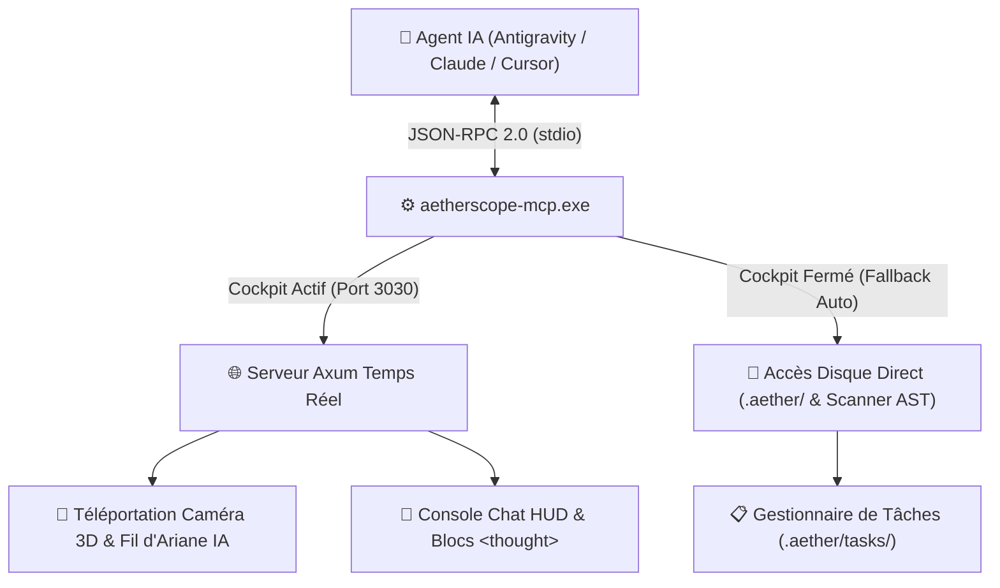

<div align="center">

# 🪐 AetherScope V2 (`aether-engine`)

### **Cockpit Spatial d'Architecture WebGL 2 (120 FPS) • Linter SAST Zero-Day (90+ CVE) • Gouvernance Cryptographique BLAKE3 • Serveur MCP & Passerelle IA "Zero-Shell"**

[](https://www.rust-lang.org/)
[](https://www.khronos.org/webgl/)
[](https://modelcontextprotocol.io/)
[](#️-moteur-sast-chasse-zero-day--catalogue-des-90-règles-cvecwe)
[](#🔒-gouvernance-spec-driven-contrats-ears--sceau-blake3)
[](#📄-licence)

*Développé en **Rust 100% pur**, compilé en exécutables natifs autonomes ultra-légers (`~9 Mo`), sans Electron, sans runtime lourd, sans navigateur externe et sans console noire CMD.*

</div>

---

## ⚡ Qu'est-ce qu'AetherScope V2 ?

**AetherScope V2** est un environnement d'ingénierie logicielle et d'audit de sécurité de nouvelle génération qui fusionne **quatre outils en un seul moteur natif** :

| ADN du Moteur | Ce qu'il remplace / transcende | Ce qu'apporte AetherScope V2 |
| :--- | :--- | :--- |
| 🌌 **1. Graphe Spatial Vivant** *(L'ADN Obsidian)* | Graphes statiques lents, diagrammes UML figés | **Galaxie interactive 2D/3D à 120 FPS** (Shaders SDF WebGL 2), membranes cellulaires vivantes à 12 lobes, 4 layouts mathématiques, simulation physique de Coulomb/Hooke et audio procédural. |
| 🛡️ **2. Scanner SAST & Bug Bounty** *(L'ADN Audit Zero-Day)* | Linters lents en CI/CD, bruit massif de faux positifs | **Audit statique temps réel (< 50 ms à chaque `Ctrl+S`)** avec **90+ règles CVE/CWE** (Rust/LLVM/UB, Smart Contracts & VMs Distribuées, DeFi, ZK-SNARKs, Python, Node/V8, C/C++), masquage lexical anti-faux-positifs et **Générateur de PoC & Scope Bug Bounty**. |
| 🏛️ **3. Cockpit IDE "Spec-Driven"** *(L'ADN Gouvernance)* | Documentation obsolète, dérive architecturale | Chaque dossier possède son contrat `README.md` (règles **EARS**, budgets de lignes, imports autorisés/interdits) **scellé cryptographiquement par BLAKE3** dans `aether.lock.toml`. Toute transgression allume un laser rouge d'alerte. |
| 🤖 **4. Serveur MCP & Pont IA "Zero-Shell"** *(L'ADN Copilot Console)* | Context loss des LLMs, réécritures destructrices, hallucinations | **Serveur MCP natif (`aetherscope-mcp.exe`)** + **Paquets `<aether_handshake>`**. L'agent IA (Antigravity, Claude, Cursor) téléporte lui-même la caméra 3D sur les bulles qu'il édite, gère ses tâches dans `.aether/tasks/` et code par diffs chirurgicaux sans jamais perdre le contexte. |

---

## 📌 Sommaire Exécutif

1. [Architecture Globale & Structure du Workspace Cargo](#-architecture-globale--structure-du-workspace-cargo)
2. [Cockpit GPU WebGL 2 : Membranes, Bulles, Lasers & Layouts](#-cockpit-gpu-webgl-2--membranes-bulles-lasers--layouts)
   - [Architecture Graphique Dual-Layer & Plateau Cybernétique 3D](#architecture-graphique-dual-layer--plateau-cybernétique-3d)
   - [Nuages & Membranes Cellulaires Biologiques à 12 Lobes](#nuages--membranes-cellulaires-biologiques-à-12-lobes)
   - [Taxonomie des Bulles de Symboles & 3 Niveaux de Détail (LoD)](#taxonomie-des-bulles-de-symboles--3-niveaux-de-détail-lod)
   - [Les 6 Filtres d'Affiliation Lasers (`bitflags`) & Pipeline E2E](#les-6-filtres-daffiliation-lasers-bitflags--pipeline-e2e)
   - [Les 4 Algorithmes Mathématiques de Layout (`Z-1` à `Z-4`)](#les-4-algorithmes-mathématiques-de-layout-z-1-à-z-4)
   - [Modes de Vision Analytique (X-Ray, Dead Code, Heatmap), Physique & Audio](#modes-de-vision-analytique-x-ray-dead-code-heatmap-physique--audio)
3. [Outillage IDE Intégré, Scaffolding Multi-Stack & Export](#-outillage-ide-intégré-scaffolding-multi-stack--export)
   - [Omnibox Deep Search (`Ctrl+K`) & Inspecteur à 4 Onglets](#omnibox-deep-search-ctrlk--inspecteur-à-4-onglets)
   - [Lecteur / Éditeur Markdown & Hub de Scaffolding Multi-Architecture](#lecteur--éditeur-markdown--hub-de-scaffolding-multi-architecture)
4. [Serveur MCP Natif (`aetherscope-mcp`) & Passerelle IA "Zero-Shell"](#-serveur-mcp-natif-aetherscope-mcp--passerelle-ia-zero-shell)
   - [Architecture JSON-RPC 2.0 & Double Mode Opérationnel Résilient](#architecture-json-rpc-20--double-mode-opérationnel-résilient)
   - [Catalogue Exhaustif des 9 Outils MCP](#catalogue-exhaustif-des-9-outils-mcp)
   - [Sous-Système de Tâches & Quêtes Hybride (`.aether/tasks/`)](#sous-système-de-tâches--quêtes-hybride-aethertasks)
   - [Console Chat Copilot (`<thought>`), Télémétrie Spatiale & `<aether_handshake>`](#console-chat-copilot-thought-télémétrie-spatiale--aether_handshake)
   - [Configuration Universelle (Antigravity, Claude Desktop, Cursor)](#configuration-universelle-antigravity-claude-desktop-cursor)
5. [Gouvernance "Spec-Driven", Contrats EARS & Sceau BLAKE3](#-gouvernance-spec-driven-contrats-ears--sceau-blake3)
6. [Moteur SAST, Chasse Zero-Day & Catalogue des 90+ Règles CVE/CWE](#️-moteur-sast-chasse-zero-day--catalogue-des-90-règles-cvecwe)
   - [Masquage Lexical Anti-Faux-Positifs & Préparateur de Scope Bug Bounty / PoC](#masquage-lexical-anti-faux-positifs--préparateur-de-scope-bug-bounty--poc)
   - [1. Rust Bas-Niveau, LLVM Codegen, ABI, Unwind & OS Kernel (24 règles)](#1-rust-bas-niveau-llvm-codegen-abi-unwind--os-kernel)
   - [2. Consensus L1, Runtimes Wasm & Réseaux P2P (6 règles)](#2-consensus-l1-runtimes-wasm--réseaux-p2p)
   - [3. Smart Contracts EVM, Account Abstraction & Cross-Chain (30 règles)](#3-smart-contracts-evm-account-abstraction--cross-chain)
   - [4. Protocoles DeFi, Invariants de Vaults & Oracles (7 règles)](#4-protocoles-defi-invariants-de-vaults--oracles)
   - [5. Preuves ZK-SNARKs & Machines Virtuelles Alternatives (7 règles)](#5-preuves-zk-snarks--machines-virtuelles-alternatives)
   - [6. MMO, Concurrence & Boucle de Jeu Temps Réel (5 règles)](#6-mmo-concurrence--boucle-de-jeu-temps-réel)
   - [7. SAST Fondamental, RCE & Injections Multi-Langages (18 règles)](#7-sast-fondamental-rce--injections-multi-langages)
   - [8. Front-End, DOM & Écosystème Node.js / V8 Internals (13 règles)](#8-front-end-dom--écosystème-nodejs--v8-internals)
   - [9. Architecture, Intégrité & Contrats EARS (4 règles)](#9-architecture-intégrité--contrats-ears)
   - [10. C / C++ & Modules Natifs FFI (1 règle)](#10-c--c--modules-natifs-ffi)
7. [API REST Locale (24 Routes), Options CLI, Raccourcis & Compilation](#-api-rest-locale-24-routes-options-cli-raccourcis--compilation)

---

## 🏛️ Architecture Globale & Structure du Workspace Cargo

Le moteur est découpé en **6 crates Rust** strictement isolés selon les principes de l'Architecture Hexagonale :

```text
aether-engine/
├── Cargo.toml                              # Workspace Cargo unifié (Edition 2021)
├── README.md                               # Spécification officielle & documentation exhaustive
├── AETHER_AI_RULES.md                      # Directives système injectées aux Agents IA
├── aether.lock.toml                        # Sceau cryptographique BLAKE3 des contrats de dossiers
├── .aether/                                # Pont de fichiers temps réel Zero-Shell (< 50 ms)
│   ├── LIVE_AUDIT.md                       # Rapport de santé & CVE en direct (mis à jour à chaque Ctrl+S)
│   ├── ACTIVE_TARGET.md                    # Contexte chirurgical du symbole actuellement inspecté
│   ├── TASKS_SUMMARY.md                    # Tableau de bord récapitulatif des tâches & quêtes
│   └── tasks/                              # Dossier persistant des tâches autonomes (Modèle & Humain)
│       └── <task_id>/
│           ├── task.json                   # Métadonnées machine (statut, priorité, progression 0-100%)
│           └── README.md                   # Journal technique et plan d'avancement de l'agent
│
└── crates/
    ├── core-graph/                         # 1. Modèle de données & Algorithmes géométriques
    │   ├── src/bubble.rs                   # SymbolBubble, SymbolKind, Point2D, CveAnomalyRecord
    │   ├── src/edge.rs                     # AffiliationEdge, CategorizedLiaisons, FilterAffiliation (bitflags)
    │   ├── src/graph.rs                    # AetherGraph, calculs de degrés, stats & métriques
    │   ├── src/layout.rs                   # 4 Algorithmes de layout (Obsidian, System, Flow DAG, UML)
    │   └── src/manifest.rs                 # Manifestes de topologies logicielles & verrou BLAKE3
    │
    ├── ast-scanner/                        # 2. Scanner AST Polyglotte Multithread (Rayon)
    │   └── src/scanner.rs                  # Regex OnceLock (Rust, TS/JS, Python, C/C++, Smart Contracts, MD)
    │
    ├── security-linter/                    # 3. Moteur SAST Zero-Day, Lexer & Contrats BLAKE3
    │   ├── src/contract.rs                 # Parseur README.md (YAML frontmatter + règles EARS + BLAKE3)
    │   ├── src/lexer.rs                    # Masquage lexical des littéraux/commentaires (Anti-Faux-Positifs)
    │   ├── src/rules.rs                    # Règles avancées DeFi, Vaults, Oracles & Taint Tracking
    │   ├── src/deep_rules.rs               # Règles d'élite (Rust LLVM/UB/ABI/Kernel, ZK-SNARKs, Runtimes VM)
    │   └── src/linter.rs                   # Catalogue central de 90+ règles CVE/CWE & orchestrateur d'audit
    │
    ├── ai-file-bridge/                     # 4. Passerelle IA Zero-Shell & Gestionnaire de Tâches
    │   ├── src/watcher.rs                  # FileWatcher réactif notify (< 50 ms)
    │   ├── src/tasks.rs                    # TaskManager CRUD (task.json, mini-README, TASKS_SUMMARY.md)
    │   ├── src/audit_writer.rs             # Générateur de LIVE_AUDIT.md, ACTIVE_TARGET.md et prompts système
    │   └── src/handshake.rs                # Sérialiseur XML <aether_handshake version="2.0"> & [AETHER_ACK]
    │
    ├── arch-templates/                     # 5. Hub de Topologies & Scaffolding Multi-Stack
    │   └── src/templates.rs                # Générateur de squelettes (Rust, Python uv, Node pnpm, MMO/Web3)
    │
    └── desktop-shell/                      # 6. Exécutable Desktop Natif (tao/wry) & Serveur MCP
        ├── src/main.rs                     # Fenêtre native WebView2 GPU, serveur Axum (port 3030)
        ├── src/mcp_main.rs                 # Binaire autonome aetherscope-mcp.exe (Stdio JSON-RPC 2.0)
        ├── src/mcp.rs                      # Implémentation des 9 outils MCP avec fallback direct sur disque
        ├── src/api_routes.rs               # Modèles DTO, signature BLAKE3, scaffolding & dialogues OS natifs
        ├── src/viewer.rs                   # Compilateur d'assets et exportateur HTML standalone
        └── assets/                         # Cockpit Frontend modulaire (Zéro framework lourd, 100% natif)
            ├── index.html                  # Squelette DOM sémantique, topbar, inspecteur & modales
            ├── styles.css                  # Design system cosmique (:root, lasers néon, badges BLAKE3)
            ├── state_api.js                # State store réactif, synthétiseur AudioSys & client REST AetherAPI
            ├── webgl_shaders_physics.js    # Shaders GLSL SDF WebGL 2 & moteur physique Coulomb/Hooke
            ├── webgl_renderer.js           # Rendu instancié 120 FPS, membranes à 12 lobes & photons lasers
            ├── ui_navigation.js            # Caméra inertielle lerp, zoom LoD, survol spatial & sélection
            ├── ui_inspector_docs.js        # Inspecteur 4 onglets, lecteur/éditeur Markdown, sceau BLAKE3
            ├── ui_vision_modes.js          # Modes X-Ray, Dead Code, Heatmap, CVE Triage & Bug Bounty Scope
            └── ui_ai_modals.js             # Omnibox, Copilot Chat, Tâches, Télémétrie, MCP & Paramètres
```

---

## 🎨 Cockpit GPU WebGL 2 : Membranes, Bulles, Lasers & Layouts

### Architecture Graphique Dual-Layer & Plateau Cybernétique 3D

Pour maintenir un rafraîchissement constant à **120 FPS** sur des graphes de plusieurs milliers de nœuds tout en affichant des membranes organiques et des faisceaux lasers lumineux, AetherScope V2 superpose deux canvas synchronisés :

1. **Canvas WebGL 2 Principal (Arrière-plan GPU instancié) :**
   - Rendu par Shaders GLSL SDF (*Signed Distance Field*).
   - Le champ d'étoiles profond et les halos néon des bulles sont projetés sur le GPU en un seul appel instancié (`gl.drawArraysInstanced`).
   - Les *Vertex Buffer Objects* (VBO) ne sont mis à jour que lorsque la simulation physique déplace effectivement les coordonnées.
2. **Canvas 2D Haute Définition Superposé (Avant-plan vectoriel) :**
   - **Plateau Cybernétique 3D en Perspective :** Applique une projection spatiale inclinée :
     $$y_{3D} = y_{\text{monde}} + (y_{\text{monde}} - y_{\text{centre}}) \times 0.35$$
   - Dessine la grille stellaire avec horizon zénithal, les membranes biologiques à double feuillet lipidique, les faisceaux lasers d'affiliation, les photons animés et les étiquettes typographiques.

---

### Nuages & Membranes Cellulaires Biologiques à 12 Lobes

Chaque dossier du projet constitue un cluster planétaire enveloppé d'une **membrane cellulaire vivante** calculée en temps réel :

```text
          .---''''''---.
        /   (Lobe 1)     \
       |  .------------.  |  <--- Double feuillet lipidique (Lipid Bilayer)
      /  /   Symboles   \  \
     |  |    Enfants     |  | <--- Confinement élastique (Tension superficielle)
      \  \   Confinés   /  /
       |  '------------'  |
        \   (Lobe 12)    /   <--- Respiration multi-harmonique (12 lobes)
          '---......---'
```

- **Équation de Respiration Multi-Harmonique :** La membrane est interpolée par une spline quadratique fermée à **12 lobes équidistants** ($\Delta\theta = \frac{2\pi}{12}$) avec continuité $C^1$. Le rayon instantané de chaque lobe $i \in [0, 11]$ oscille selon le nombre d'or ($\phi \approx 1.618$) et la constante d'Euler ($e \approx 2.718$) pour éliminer toute répétition mécanique :
  $$\text{bioWave}(i, t) = \sin(t \times 0.0018 + i \times 1.618) \times 0.12 + \cos(t \times 0.0031 + i \times 2.718) \times 0.06$$
  $$R_i(t) = R_{\text{base}} \times \bigl(1.0 + \text{bioWave}(i, t)\bigr)$$
- **Flottement Orbital Brownien & Confinement Élastique :** Chaque cluster dérive doucement dans l'espace selon un déphasage issu du hachage de son chemin, et exerce une force de rappel membranaire sur ses symboles enfants pour garantir l'étanchéité visuelle du dossier.
- **Éclosion Aquatique par Vagues & Supernova :** À l'ouverture d'un projet, les dossiers émergent en 8 vagues rythmiques successives. Lorsqu'un fichier est créé par l'ingénieur ou l'IA, une onde de choc **Supernova** illumine le cluster.

---

### Taxonomie des Bulles de Symboles & 3 Niveaux de Détail (LoD)

Chaque entité du code source est représentée par une bulle dont la géométrie et la couleur néon reflètent immédiatement la nature architecturale :

| Stéréotype (`SymbolKind`) | Rayon de Base | Couleur Néon | Code Hex | Rôle Architectural |
| :--- | :---: | :---: | :---: | :--- |
| **`Function`** | $5\text{px}$ à $16\text{px}$ | **Cyan Stellaire** | `#38bdf8` | Fonction ou méthode atomique. Son rayon croît avec sa complexité cyclomatique de McCabe. |
| **`File`** | $14\text{px}$ | **Violet Néon** | `#a855f7` | Fichier source conteneur hébergeant structures, fonctions et imports. |
| **`ClassOrStruct`** | $10\text{px}$ | **Émeraude Cyber** | `#22c55e` | Structure Rust, Enum, Trait, Classe POO, Interface TypeScript ou Modèle Pydantic. |
| **`FormOrEndpoint`** | $9\text{px}$ | **Orange Solaire** | `#f97316` | Passerelle d'Entrées/Sorties : formulaire UI (`«Form»`), route HTTP (`«Endpoint»`) ou handler WS. |
| **`Contract` / `Doc`** | $12\text{px}$ | **Or / Rouge Rubis** | `#f59e0b` / `#ef4444` | Contrat de dossier `README.md` contenant les règles EARS et le sceau BLAKE3. |
| **`Folder` (Cluster)** | Dynamique | Palette Cosmique | Variable | Dossier architectural englobant, délimité par sa membrane biologique à 12 lobes. |

#### Les 3 Niveaux de Détail Sémantiques (LoD)
- **LOD 1 (Macro — Vue Galactique) :** Affiche uniquement les membranes des dossiers et leurs bannières de titres.
- **LOD 2 (Méso — Vue Constellations) :** Dévoile les fichiers, classes, fonctions et les faisceaux lasers principaux.
- **LOD 3 (Micro — Inspection Chirurgicale) :** Affiche les signatures complètes, les scores de complexité, les badges d'alerte SAST et les étiquettes de protocoles sur les arêtes.

---

### Les 6 Filtres d'Affiliation Lasers (`bitflags`) & Pipeline E2E

Toutes les liaisons du graphe sont encodées sur un masque binaire `u32` (`FilterAffiliation`) permettant un filtrage instantané en $O(1)$ sans réallocation :

```rust
bitflags! {
    pub struct FilterAffiliation: u32 {
        const PHYSICAL          = 1 << 0; // Bit 1  : Structure physique Dossier -> Fichier -> Symbole
        const NETWORK_RPC       = 1 << 1; // Bit 2  : Client Fetch / Formulaire UI -> Route API Serveur
        const REALTIME_WS       = 1 << 2; // Bit 4  : Canaux WebSocket Temps Réel (socket.emit / Packets)
        const SEMANTIC          = 1 << 3; // Bit 8  : Appels de fonctions, imports, héritage & docs
        const SECURITY_VIOLATES = 1 << 4; // Bit 16 : Violations SAST, CVE & Contrats BLAKE3 (Laser Rouge)
        const DATABASE_QUERY    = 1 << 5; // Bit 32 : Requêtes SQL, Repositories & Stores de persistance
    }
}
```

```text
               [ Formulaire UI / Client ]
                           │
           (NETWORK_RPC)   │  ⚡ Laser Orange (#f97316) — fetch('/api/...')
                           ▼
                 [ Handler API Serveur ]
                           │
           (REALTIME_WS)   │  ⚡ Laser Cyan (#00f0ff) — WebSocket / Packet
                           ▼
               [ Orchestrateur / Domaine ]
                           │
          (DATABASE_QUERY) │  ⚡ Laser Émeraude (#10b981) — SQL / Repository
                           ▼
                  [ Base de Données ]
                           ▲
       (SECURITY_VIOLATES) ┆  🚨 Laser Rouge Clignotant 3 Hz (#ef4444) — Alerte CVE / Contrat
                           │
               [ Composant Non Conforme ]
```

- **Mode Traçabilité Pipeline E2E :** Active la mise en évidence bout-en-bout du cycle de vie de la donnée (`Formulaire Submit ➔ Requête HTTP ➔ Canal WebSocket ➔ Base de Données`).
- **Particules Photons Animées :** Des photons lumineux glissent le long des faisceaux lasers actifs selon l'équation paramétrique $s(t) = (t \times v + \phi_0) \pmod 1$, matérialisant le sens réel du flux d'information.

---

### Les 4 Algorithmes Mathématiques de Layout (`Z-1` à `Z-4`)

Basculez instantanément entre 4 topologies géométriques interpolées à 120 FPS avec les touches <kbd>1</kbd>, <kbd>2</kbd>, <kbd>3</kbd>, <kbd>4</kbd> :

1. **Layout `Z-1` — Obsidian Galaxy (<kbd>1</kbd> — Vue Organique par Dossiers) :**
   - Dispose les clusters selon la **spirale dorée de Fermat** basée sur l'angle d'or :
     $$\theta = n \times 137.507764^\circ \quad (\approx 2.399963\text{ rad}), \qquad r = c \sqrt{n}$$
   - Garantit une répartition isotrope optimale sans chevauchement quel que soit le nombre de modules.
2. **Layout `Z-2` — Architecture Système (<kbd>2</kbd> — Strates Verticales) :**
   - Aligne rigoureusement les symboles sur **7 couches d'architecture logicielle** :
     `docs` ($-750\text{px}$) ➔ `ui` ($-580\text{px}$) ➔ `config` ($-380\text{px}$) ➔ `action` ($-220\text{px}$) ➔ `domain` ($+160\text{px}$) ➔ `utility` ($+380\text{px}$) ➔ `database` ($+540\text{px}$).
3. **Layout `Z-3` — Flux d'Exécution DAG (<kbd>3</kbd> — Pipeline Horizontal) :**
   - Organise les symboles de gauche à droite selon **4 stations séquentielles** :
     *Étape 0 : Rendu UI (`render_*`)* ➔ *Étape 1 : Entrée/Trigger (`fetch_*`, `handle_*`)* ➔ *Étape 2 : Cœur Métier (Domaine)* ➔ *Étape 3 : Persistance (`save_*`, `update_*`)*.
4. **Layout `Z-4` — Matrice Classes & Contrats UML (<kbd>4</kbd>) :**
   - Ordonne les structures, classes, traits, interfaces et contrats sur une grille cartésienne régulière ($240\text{px} \times 120\text{px}$).

---

### Modes de Vision Analytique (X-Ray, Dead Code, Heatmap), Physique & Audio

- 🔦 **Mode X-Ray Focus Tunnel (<kbd>X</kbd>) :** Plonge l'ensemble du cosmos à $5\%$ d'opacité et n'illumine que le **cône causal complet** (tous les appelants amont récursifs et toutes les dépendances aval récursives) du symbole sélectionné.
- 💀 **Mode Dead Code Scanner (<kbd>D</kbd>) :** Isole tous les symboles et fichiers orphelins ($\text{in-degree} = 0$, hors points d'entrée légitimes `main`/`index`/configs), chiffre les lignes de code (LOC) économisables et génère un **Prompt IA de nettoyage chirurgical** en un clic.
- 🌡️ **Mode Heatmap de Santé & Complexité (<kbd>H</kbd>) :** Attribue une note globale de santé sur 100 au projet, colorise chaque bulle selon son indice thermique (couplage entrant/sortant + complexité McCabe + LOC) et épingle le **Top 5 des Hotspots** à refactoriser.
- 🧲 **Gravité Quantique (<kbd>G</kbd>) :** Simulation physique combinant répulsion électrostatique de Coulomb ($F_{\text{rep}} = k_e / d^2$), ressorts d'affiliation de Hooke ($F = -k(d - d_0)$) et amortissement inertiel ($\text{damping} = 0.88$).
- 🔊 **Synthétiseur Audio Procédural (`AudioSys`) :** Moteur sonore cybernétique généré à $100\%$ en temps réel via la **Web Audio API** (oscillateurs sinusoïdaux/triangulaires pour les survols, accords harmoniques de téléportation, onde aquatique au chargement, sirène douce sur violation CVE).

---

## 🛠️ Outillage IDE Intégré, Scaffolding Multi-Stack & Export

### Omnibox Deep Search (`Ctrl+K`) & Inspecteur à 4 Onglets

- **Omnibox de Recherche Profonde (<kbd>Ctrl</kbd>+<kbd>K</kbd> ou <kbd>/</kbd>) :**
  - Recherche instantanée pondérée à travers **8 catégories** : *Tous*, *Dossiers*, *Fichiers*, *Classes/Structs*, *Fonctions*, *Formulaires/Endpoints*, *Docs `.md`* et *Alertes CVE*.
  - Fouille jusque dans les noms de méthodes internes, les appels sous-jacents, les champs de structures et le contenu des docstrings.
  - Sélectionner un résultat déclenche un vol cinématique de caméra (*Fly-To*) et allume une **balise à onde de choc pulsante** sur la cible.
- **Inspecteur Latéral à 4 Onglets (<kbd>I</kbd>) :**
  1. **Onglet Débrief :** Affiche les KPIs (lignes de code, complexité McCabe, degrés In/Out), la déclaration complète, la docstring extraite de l'AST, le statut du sceau BLAKE3 et les boutons **Handshake IA 1-Clic**.
  2. **Onglet Architecture UML & Mini-DAG :** Génère la carte UML de la structure/classe (attributs typés `+`, méthodes et types de retour) ainsi qu'un **mini-graphe vectoriel SVG** interactif centré sur le nœud.
  3. **Onglet Relations :** Liste cliquable et catégorisée de tous les appelants amont et sous-appels aval.
  4. **Onglet Anomalies CVE (`🚨`) :** Centre de tri interactif des vulnérabilités détectées avec filtres par sévérité (`CRITICAL`, `HIGH`) et par langage (`🦀 Rust`, `🌐 Web3`, `🟢 Node/TS`, `🐍 Python`, `⚙️ C/C++`, `🏛️ Arch`), explication détaillée du vecteur d'attaque, remédiation et génération de PoC en 1 clic.

---

### Lecteur / Éditeur Markdown & Hub de Scaffolding Multi-Architecture

- **Lecteur & Éditeur Markdown Intégré (<kbd>M</kbd>) :**
  - Panneau latéral gauche permettant de lire et d'éditer directement les fichiers `README.md` et spécifications de chaque dossier.
  - La sauvegarde depuis le cockpit recalcule et scelle automatiquement l'empreinte **BLAKE3** dans `aether.lock.toml`.
- **Project Hub & Scaffolder Multi-Stack (`🔨 Forger Architecture`) :**
  - Initialise en un clic un nouveau projet complet pré-architecturé en **11 dossiers normés** (`contracts`, `client/ui`, `client/state`, `server/domain`, `server/application`, `server/api`, `data-nodes/db-primary`, `data-nodes/cache-worker`, etc.) selon 4 stacks au choix :
    1. 🦀 **Pure Rust** (Cargo Workspace Hexagonal, traits `RepositoryPort`, DTOs Serde).
    2. 🐍 **Pure Python (`uv`)** (Clean Monorepo, schémas stricts Pydantic v2, FastAPI, SQLAlchemy 2).
    3. 🟢 **Node.js / TypeScript (`pnpm`)** (Validation Zod de bout en bout, routeurs tRPC/Hono, Drizzle/Prisma).
    4. ⚡ **Hybride Web3 & Temps Réel MMO** (Paquets WebSocket binaires, ABIs Smart Contracts, état déterministe).
  - Chaque dossier est généré avec son contrat `README.md` EARS pré-signé en BLAKE3, son code de démarrage documenté et son fichier maître `AETHER_AI_RULES.md`.
- **Création de Fichier Assistée ("Supernova") & Exports :**
  - Créez de nouveaux modules directement depuis l'interface avec prévisualisation instantanée de leur naissance stellaire dans le graphe.
  - **Export HTML Standalone (`💾 Export Viewer`) :** Compile l'intégralité du graphe actuel et du moteur WebGL 2 en un fichier unique autonome `aetherscope_viewer.html` partageable avec un client ou une équipe d'audit sans installer AetherScope.
  - **Snapshot PNG HD (<kbd>S</kbd>) :** Capture haute définition du graphe avec filigrane contextuel.

---

## 🤖 Serveur MCP Natif (`aetherscope-mcp`) & Passerelle IA "Zero-Shell"

### Architecture JSON-RPC 2.0 & Double Mode Opérationnel Résilient

AetherScope V2 compile un second exécutable natif dédié aux agents IA : **`aetherscope-mcp.exe`**, conforme au standard officiel **Model Context Protocol (JSON-RPC 2.0 sur `stdio`)**.



- **Mode 1 — Live Axum Bridge (Cockpit ouvert) :** Chaque appel d'outil MCP par l'IA anime le cockpit sous les yeux du développeur (téléportation caméra 3D, allumage de balise quantique, mise à jour du chat et des barres de progression de tâches).
- **Mode 2 — Direct File Fallback (Cockpit fermé) :** Si l'interface graphique n'est pas lancée, `aetherscope-mcp.exe` exécute directement le scanner AST/SAST et manipule les fichiers `.aether/` sur disque. **Aucun appel MCP n'échoue jamais.**

---

### Catalogue Exhaustif des 9 Outils MCP

| Outil MCP | Paramètres Clés | Impact Opérationnel & Synchronisation Cockpit |
| :--- | :--- | :--- |
| **`aetherscope_get_graph_summary`** | `path?` | Retourne l'architecture globale du projet : nombre de nœuds, flux, répartition des dossiers, score de santé et décompte des violations CVE. |
| **`aetherscope_get_active_target`** | `symbol_id?` | Extrait le contexte chirurgical d'un symbole : code, docstring, **flux entrants/sortants classés en 6 catégories** (UI, HTTP, WS, DB, Contrats, Appels), règles EARS et tâches liées. |
| **`aetherscope_teleport_camera`** | `target`, `action?`, `details?` | **Téléporte la caméra 3D du cockpit** sur le symbole ou dossier ciblé par l'IA, trace le fil d'Ariane stellaire et affiche l'action en cours dans le bandeau de télémétrie. |
| **`aetherscope_scan_project`** | `path?` | Déclenche à chaud une ré-analyse AST multithread et un audit SAST complet (< 100 ms) et rafraîchit le graphe WebGL 2. |
| **`aetherscope_create_task`** | `title`, `kind?`, `target_symbol?`, `target_file?`, `priority?`, `initial_readme?` | Crée une tâche persistante (`function`, `research`, `security_fix`, `arch_refactor`, `documentation`, `test`) avec son dossier `.aether/tasks/<id>/`, son `task.json` et son mini-`README.md`. |
| **`aetherscope_update_task`** | `task_id`, `status?`, `progress?`, `progress_note?`, `full_readme?` | Met à jour le statut (`pending`, `in_progress`, `blocked`, `done`), le pourcentage `0-100%` et enrichit le journal technique Markdown de la tâche. |
| **`aetherscope_list_tasks`** | `status_filter?` | Liste toutes les tâches actives/terminées et synchronise automatiquement `.aether/TASKS_SUMMARY.md`. |
| **`aetherscope_send_chat_message`** | `text`, `thought?`, `target_symbol?` | Publie un compte-rendu ou une question dans la **Console Chat Copilot** du cockpit, avec affichage dédié des réflexions internes `<thought>` et bouton de centrage caméra. |
| **`aetherscope_get_chat_history`** | *(aucun)* | Lit l'historique des messages échangés dans le cockpit pour maintenir une continuité conversationnelle parfaite. |

---

### Sous-Système de Tâches & Quêtes Hybride (`.aether/tasks/`)

Accessible via la touche <kbd>T</kbd> dans le cockpit ou via MCP par l'agent IA, le gestionnaire de tâches permet un suivi d'ingénierie partagé entre l'humain et le modèle :

```text
.aether/
├── TASKS_SUMMARY.md                            # Synthèse Markdown auto-générée de toutes les missions
└── tasks/
    └── task_975123_audit_securite/
        ├── task.json                           # Métadonnées (id, kind, status, progress: 75%, target_symbol, author)
        └── README.md                           # Plan d'investigation, checklists [x] et journal d'avancement IA
```

Depuis la modale **Tâches & Quêtes (<kbd>T</kbd>)**, vous pouvez créer des missions, modifier leur statut ou leur jauge de progression, éditer leur mini-`README.md` et **téléporter la caméra en 1 clic** sur le symbole associé à la tâche.

---

### Console Chat Copilot (`<thought>`), Télémétrie Spatiale & `<aether_handshake>`

- **Console Chat Copilot Draggable (<kbd>C</kbd>) :**
  - Fenêtre de dialogue flottante et déplaçable avec indicateur d'état en direct (`🟢 En écoute`, `🧠 Gemini réfléchit...`, `✅ Réponse reçue`), bouton d'interruption (`🛑 Annuler`) et gestion de sessions.
  - **Encapsulation native des blocs `<thought>...</thought>` :** Les raisonnements internes de l'IA sont automatiquement extraits dans un accordéon rétractable pour garder les réponses techniques limpides.
  - Cliquer sur n'importe quel message de l'IA aligne instantanément la caméra 3D sur la bulle concernée.
- **Bandeau de Télémétrie Spatiale (<kbd>A</kbd>) & Auto-Cam :**
  - Affiche en temps réel la cible et l'action de l'IA. Lorsque **🎥 Auto-Cam** est activé, la caméra suit automatiquement l'agent IA de bulle en bulle au fil de son exploration du code.
- **Protocole `<aether_handshake version="2.0">` & Preuve `[AETHER_ACK]` :**
  - Cliquer sur un bouton d'action rapide dans l'inspecteur génère un paquet XML ultra-compact (~300 tokens) contenant la topologie exacte du symbole ciblé :

```xml
<aether_handshake version="2.0">
  <target_symbol id="crates::security_linter::SecurityLinter" kind="ClassOrStruct" file="crates/security-linter/src/linter.rs" line="59">
    <metrics lines="890" cyclomatic_complexity="12" in_degree="8" out_degree="4" />
  </target_symbol>
  <contract_status folder="crates/security-linter" verified="true" blake3_hash="8f4a2c..." max_lines="300" />
  <categorized_flows>
    <incoming_callers count="8">ProjectScanner::scan_project_with_exclusions, ...</incoming_callers>
    <outgoing_dependencies count="4">ReadmeContract::parse, AdvancedDefiRules::audit_file, ...</outgoing_dependencies>
  </categorized_flows>
  <task objective="Refactorisation & Performance">
    Respecter les invariants du module et répondre avec l'en-tête [AETHER_ACK].
  </task>
</aether_handshake>
```

---

### Configuration Universelle (Antigravity, Claude Desktop, Cursor)

Ouvrez la modale **🔌 Connecter MCP** dans le cockpit pour copier la configuration prête à l'emploi, ou ajoutez ce bloc dans votre fichier de configuration MCP (`~/.gemini/config/mcp_config.json`, `.cursor/mcp.json` ou `claude_desktop_config.json`) :

```json
{
  "mcpServers": {
    "aetherscope": {
      "command": "C:\\Chemin\\Vers\\aether-engine\\target\\release\\aetherscope-mcp.exe",
      "args": ["--port", "3030"]
    }
  }
}
```

---

## 🔒 Gouvernance "Spec-Driven", Contrats EARS & Sceau BLAKE3

Pour empêcher les agents IA ou les développeurs de dégrader l'architecture (imports circulaires, logique I/O dans le domaine pur, fichiers monolithiques de 3000 lignes), chaque dossier peut contenir un contrat `README.md` doté d'un en-tête YAML et de règles **EARS** (*Easy Approach to Requirements Syntax*) :

```markdown
---
id: server-domain
layer: domain
max_lines_per_file: 200
allowed_imports: ["contracts::*"]
forbidden_imports: ["server/api::*", "client::*", "data-nodes::*"]
security_rules:
  no_raw_sql: true
  no_env_access: true
  deterministic_only: true
---
# 🏛️ Logique Métier Pure (Domain)

## 🛡️ Règles EARS
- WHEN domain rule is evaluated THE SYSTEM SHALL execute deterministically without I/O.
- IF input nights exceed 90 THEN THE SYSTEM SHALL return a domain validation error.
```

1. **Vérification Continue (< 50 ms) :** À chaque sauvegarde, `security-linter` vérifie que nul fichier du dossier ne dépasse `max_lines_per_file` (`RULE_MAX_LINES`), n'importe un module de `forbidden_imports` (`RULE_FORBIDDEN_IMPORT`), ni n'accède aux variables d'environnement ou au réseau si `deterministic_only: true` (`SAST_DIRECT_ENV_ACCESS`).
2. **Sceau Cryptographique BLAKE3 (`aether.lock.toml`) :** L'empreinte BLAKE3 de chaque `README.md` est enregistrée dans `aether.lock.toml`. Si un agent IA modifie le `README.md` pour assouplir une règle sans que l'ingénieur humain ne clique sur **« 🔒 Signer Contrat »**, la violation critique `BLAKE3_TAMPERED` illumine le graphe en rouge.

---

## 🛡️ Moteur SAST, Chasse Zero-Day & Catalogue des 90+ Règles CVE/CWE

### Masquage Lexical Anti-Faux-Positifs & Préparateur de Scope Bug Bounty / PoC

Contrairement aux scanners par expressions régulières classiques qui génèrent des centaines de faux positifs sur les commentaires ou les fichiers de tests, le moteur SAST d'AetherScope V2 intègre :

1. **Un Lexer Multi-Langages (`lexer.rs`) à Double Passe :** Masque automatiquement les commentaires (`//`, `/* */`, `#`, docstrings) et les littéraux de chaînes non pertinents avant d'évaluer les règles syntaxiques, tout en tronquant automatiquement les modules de tests unitaires Rust inline (`#[cfg(test)]`, `mod tests`).
2. **Un Préparateur de Scope Bug Bounty & Générateur de PoC (`🎯 Scope / PoC Bug Bounty`) :**
   - Permet de filtrer visuellement les dossiers **✅ IN-SCOPE** et **🚫 OUT-OF-SCOPE** (avec presets *L1 Consensus*, *Web3 DeFi*, *Rust Low-Level*) et de synchroniser ces exclusions avec le scanner.
   - **3 Modes de Génération de Prompts d'Audit :**
     - 🧪 **Mode 1 — Triage & Proof of Concept (PoC) Exécutable (Sans modifier le code) :** Impose la règle *"Zéro correction barbare"*, demande à l'IA de vérifier l'atteignabilité *Source-to-Sink*, d'écrire un test d'exploitation autonome (`#[test]` Rust, `cargo miri`, ou Foundry `test_poc`) et de rédiger le rapport final au format **Immunefi / HackerOne / Cantina**.
     - 🔬 **Mode 2 — Chasse Zero-Day Bas-Niveau :** Oriente l'audit sur les bugs subtils de compilateur LLVM, d'unwind de pile, d'ABI FFI et de désynchronisation d'état.
     - 🛡️ **Mode 3 — Patch Chirurgical Minimal :** Fournit le patron de remédiation certifié (*Gold Pattern*) pour corriger la ligne vulnérable sans effet de bord.

---

### 1. Rust Bas-Niveau, LLVM Codegen, ABI, Unwind & OS Kernel

| Identifiant Règle (`rule_id`) | Référence CWE / Classe | Gravité | Mécanisme de Faille & Vecteur d'Exploitation | Remédiation Certifiée |
| :--- | :--- | :---: | :--- | :--- |
| `CVE-RUST-LLVM-DEAD-STORE-SECRET-LEAK` | CWE-14 / LLVM DSE Secret Leak | **CRITICAL** | Effacement manuel d'une clé privée/seed via `.fill(0)` ou `write_bytes(..., 0)` sans `zeroize` ni `write_volatile` : la passe *Dead Store Elimination* de LLVM supprime l'écriture en `--release`, laissant le secret en RAM. | Utiliser `zeroize::Zeroize` (`Zeroizing<T>`) ou `ptr::write_volatile` suivi d'un `atomic::compiler_fence(SeqCst)`. |
| `CVE-RUST-UNWIND-PANIC-DOUBLE-DROP-UB` | CWE-415 / Unwind Double-Free | **CRITICAL** | Appel à `Vec::set_len(n)` avant remplissage faillible ou `ptr::read()` sans `ManuallyDrop` : un `panic!` ou `?` intermédiaire déclenche `Drop` sur de la mémoire non initialisée ou libère deux fois le pointeur (Double-Free ➔ RCE). | Mettre à jour `set_len` après le remplissage complet ou encapsuler dans un garde RAII / `ManuallyDrop`. |
| `CVE-RUST-MAYBEUNINIT-PADDING-AND-POISON-UB` | CWE-908 / LLVM Poison & Padding | **CRITICAL** | `MaybeUninit::uninit().assume_init()` (poison LLVM immédiat) ou exposition d'une struct en `&[u8]` via `slice::from_raw_parts` sans `#[repr(C)]` + `bytemuck::NoUninit` : divulgue les octets de padding (adresses ASLR/clés) sur le réseau. | Initialiser via `MaybeUninit::zeroed()` ou dériver `bytemuck::NoUninit` / `Pod` sans octets de padding. |
| `CVE-RUST-ALLOC-LAYOUT-ZERO-OR-ISIZE-OVERFLOW`| CWE-680 / GlobalAlloc UB | **CRITICAL** | Appel à `std::alloc::alloc` sans garantir `layout.size() > 0` (UB immédiat en Rust) ou `Layout::from_size_align_unchecked` sans vérifier `size <= isize::MAX - (align - 1)` (Heap Buffer Overflow). | Utiliser `Layout::from_size_align` vérifié et court-circuiter toute allocation de taille `0`. |
| `CVE-RUST-FFI-PANIC-ACROSS-ABI-BOUNDARY` | CWE-248 / FFI Unwind UB | **CRITICAL** | Fonction `extern "C" fn` contenant des opérations paniquantes (`.unwrap()`, indexation) sans `std::panic::catch_unwind` : un déroulement de pile à travers une frontière FFI C/C++/Wasm provoque un UB ou crashe le nœud. | Envelopper le corps de toute fonction `extern "C"` dans `std::panic::catch_unwind`. |
| `CVE-RUST-UNSAFECELL-CONCURRENT-MUT-NOALIAS-UB`| CWE-362 / LLVM `noalias` UB | **CRITICAL** | Création de `&mut *cell.get()` depuis un `UnsafeCell` dans une méthode `&self` sans verrou exclusif : viole l'attribut `noalias` émis par `rustc` vers LLVM `-O3`, corrompant l'état concurrent. | Synchroniser par `Mutex`/`RwLock`/`Atomic` ou manipuler des pointeurs bruts `*mut T` sans créer de `&mut T` aliasing. |
| `CVE-RUST-MMAP-EXTERNAL-TRUNCATION-SIGBUS` | CWE-367 / Mmap `SIGBUS` Crash | **HIGH** | Projection d'un fichier via `memmap2::Mmap::map` exposée en `&[u8]` sans verrouillage OS exclusif : une troncature externe du fichier déclenche un signal matériel `SIGBUS` fatal non rattrapable par `catch_unwind`. | Verrouiller exclusivement le descripteur (`flock`) ou privilégier des lectures paginées en mémoire. |
| `CVE-RUST-PIN-STRUCTURAL-UNPIN-SOUNDNESS-UB` | RUST-CRITICAL / Pin Soundness | **CRITICAL** | Projection manuelle `Pin::get_unchecked_mut` ou `Pin::new_unchecked` sans `pin_project!` sur une Future auto-référentielle : un `mem::swap` invalide les pointeurs internes entre deux `.await` (Use-After-Free). | Utiliser systématiquement `#[pin_project::pin_project]` ou `pin_project_lite!`. |
| `CVE-RUST-UNSOUND-TRANSMUTE-ALIGNMENT` | CWE-843 / Alignment UB | **HIGH** | `mem::transmute` ou `slice::from_raw_parts` vers un type d'alignement supérieur sans assertion `align_offset` / `align_of::<T>()` : provoque un UB ou un crash SIMD. | Utiliser `bytemuck::try_cast_slice` ou vérifier formellement l'alignement du pointeur. |
| `CVE-RUST-UNSOUND-SLICE-FROM-RAW-PARTS` | CWE-119 / Raw Slice UB | **CRITICAL** | `slice::from_raw_parts` ou `Vec::from_raw_parts` sur un pointeur non vérifié (potentiellement nul, non aligné ou hors bornes). | Valider via `NonNull`, vérifier l'alignement et borner strictement la longueur. |
| `CVE-RUST-DESER-BOMB-OOM` | CWE-789 / Length-Prefix OOM | **CRITICAL** | `Vec::with_capacity(wire_len)` ou désérialisation binaire (`bincode`, `rmp_serde`) sans `.with_limit()` : un préfixe forgé de 8 octets déclenche un `abort()` OOM immédiat. | Imposer `bincode::options().with_limit(MAX_BYTES)` et plafonner `with_capacity(len.min(MAX_CAP))`. |
| `CVE-RUST-UNBOUNDED-BCS-DESERIALIZE` | CWE-502 / BCS Recursion DoS | **HIGH** | Désérialisation directe `bcs::from_bytes` sans plafond d'octets ni limite de profondeur récursive. | Utiliser `bcs::from_bytes_with_limit` et borner la taille du payload entrant. |
| `CVE-RUST-CANCEL-SAFETY-LOSS` | CWE-662 / Tokio Select Loss | **HIGH** | Utilisation de futures non *cancel-safe* (`read_exact`, `write_all`, `read_to_end`) dans une branche `tokio::select!` : si une autre branche gagne, les octets partiellement lus/écrits sont perdus. | Utiliser un `tokio_util::codec::Framed` persistant hors du `select!`. |
| `CVE-RUST-ASYNC-SELECT-CANCELLATION-CORRUPTION`| CWE-662 / Async State Corrupt | **CRITICAL** | Séquence réseau multi-étapes non atomique interrompue au milieu d'un `tokio::select!`, laissant le protocole désynchronisé. | Isoler le flux dans une tâche dédiée communicant par canal `mpsc`. |
| `CVE-RUST-BLOCKING-IN-ASYNC` | CWE-400 / Executor Starvation | **CRITICAL** | Appel synchrone bloquant (`std::fs`, `std::thread::sleep`, `std::net`) dans une `async fn`, paralysant les threads workers Tokio. | Utiliser `tokio::fs`, `tokio::time::sleep` ou déporter sur `tokio::task::spawn_blocking`. |
| `CVE-RUST-TIMING-SIDECHANNEL` | CWE-208 / Timing Side-Channel | **HIGH** | Comparaison de HMAC, tokens ou signatures via `==` ou `!=` (court-circuité au premier octet par `memcmp` SIMD). | Comparer en temps constant avec `subtle::ConstantTimeEq::ct_eq()`. |
| `CVE-NET-SLOWLORIS-KEEPALIVE-DOS` | CWE-400 / Socket Exhaustion | **HIGH** | Acceptation de flux TCP/WebSocket (`accept_async`, `TcpListener::accept`) sans `tokio::time::timeout` sur le handshake. | Envelopper l'acceptation dans `tokio::time::timeout(Duration::from_secs(5), ...)`. |
| `CVE-NET-SSRF-DNS-REBIND` | CWE-918 / SSRF DNS Rebinding | **CRITICAL** | Connexion sortante (`reqwest`, `TcpStream::connect`) vers une URL dynamique sans filtrage de l'IP résolue (`127.0.0.1`, RFC 1918, `169.254.169.254`). | Résoudre le DNS une seule fois, rejeter les plages privées/loopback et désactiver les redirections. |
| `CVE-RUST-INTEGER-OVERFLOW-CAST` | CWE-190 / `as`-Cast Truncation| **HIGH** | Conversion entière 64-bit vers `u32`/`u16`/`u8` via `as` sans contrôle de bornes, tronquant silencieusement les bits de poids fort en `--release`. | Utiliser `u32::try_from(val)?` avec gestion d'erreur explicite. |
| `CVE-RUST-TRANSMUTE-SIZE-MISMATCH` | CWE-843 / Type Confusion | **CRITICAL** | Appel aveugle à `std::mem::transmute()` entre types de tailles ou layouts potentiellement divergents. | Utiliser `from_le_bytes`, `TryFrom` ou `bytemuck::cast`. |
| `CVE-RUST-FORGOTTEN-MEM-LEAK` | CWE-775 / `mem::forget` Lock | **HIGH** | Appel à `std::mem::forget()` sur un `MutexGuard`, `RwLockGuard` ou socket, empêchant l'exécution de `Drop` et causant un deadlock permanent. | Laisser le destructeur RAII s'exécuter ou appeler `drop(guard)`. |
| `CVE-RUST-UNCHECKED-INDEX-SLICING` | CWE-125 / Slice Panic DoS | **HIGH** | Indexation directe `packet[offset..offset + len]` sur un buffer réseau brut, provoquant un panic serveur sur paquet tronqué. | Valider systématiquement via `packet.get(offset..offset + len).ok_or(...)?`. |
| `CVE-RUST-THREAD-POISON-IGNORED` | CWE-391 / Swallowed Poison | **HIGH** | Récupération aveugle d'un Mutex empoisonné via `.unwrap_or_else(|e| e.into_inner())`, poursuivant l'exécution sur un état corrompu. | Propager l'erreur ou restaurer formellement les invariants de l'état partagé. |
| `CVE-RUST-FFI-UNCHECKED-NULL-PTR` | CWE-476 / FFI Null Deref | **CRITICAL** | Déréférencement direct de pointeur brut `*const T` / `*mut T` en bloc `unsafe` sans test `.is_null()`. | Convertir via `std::ptr::NonNull::new(ptr).ok_or(...)?`. |

---

### 2. Consensus L1, Runtimes Wasm & Réseaux P2P

| Identifiant Règle (`rule_id`) | Référence CWE / Classe | Gravité | Mécanisme de Faille & Vecteur d'Exploitation | Remédiation Certifiée |
| :--- | :--- | :---: | :--- | :--- |
| `CVE-L1-BORSH-UNBOUNDED-DESER-OOM` | L1-P2P / Wire Deser Bomb | **CRITICAL** | Désérialisation binaire (`try_from_slice`) ou décompression `zstd::decode_all` sur trame P2P ou témoin d'état non borné : crash OOM des nœuds validateurs. | Vérifier la signature du pair et plafonner la décompression via `.take(MAX_WITNESS_BYTES)`. |
| `CVE-L1-RUNTIME-GAS-PREPAY-BYPASS` | L1-FEE / Host-Fn Gas Bypass | **CRITICAL** | Allocation mémoire dynamique (`vec![0; len]`) ou lecture d'arbre d'état (Trie) dans une Host Function Wasm avant facturation proportionnelle du gaz (`burn_gas`). | Facturer le gaz de base et linéaire par octet avant toute allocation sur le tas hôte. |
| `CVE-L1-BALANCE-STORAGE-STAKING-DESYNC`| L1-STATE / Storage Desync | **CRITICAL** | Mutation directe de solde (`set_amount`, `saturating_sub`) sans `checked_sub` ni vérification finale de la réserve de stockage liée au compte. | Utiliser une arithmétique vérifiée et contrôler l'invariant de réserve après chaque débit. |
| `CVE-L1-CONSENSUS-UNVERIFIED-WITNESS-CHUNK`| L1-CONSENSUS / Witness | **CRITICAL** | Décompression, mise en cache ou application d'un témoin de bloc/chunk avant vérification cryptographique de la signature du producteur. | Authentifier formellement la signature du validateur avant tout traitement coûteux. |
| `CVE-L1-CROSS-SHARD-RECEIPT-NONCE-REPLAY`| L1-TX / Meta-Tx Replay | **CRITICAL** | Exécution d'une transaction déléguée sans vérifier sa hauteur d'expiration (`max_block_height`) ou sans incrémenter atomiquement le nonce en amont. | Vérifier l'expiration et incrémenter atomiquement le nonce avant émission du reçu asynchrone. |
| `CVE-L1-CRYPTO-BLIND-SCALAR-MERKLE-MALLEABILITY`| L1-CRYPTO / Torsion Split | **CRITICAL** | Décompression de point elliptique (BLS12-381 / Ed25519) via `_unchecked` sans test d'appartenance au sous-groupe d'ordre premier (`is_torsion_free`). | Rejeter les points d'ordre faible et valider l'appartenance au sous-groupe canonique. |

---

### 3. Smart Contracts EVM, Account Abstraction & Cross-Chain

| Identifiant Règle (`rule_id`) | Référence CWE / Classe | Gravité | Mécanisme de Faille & Vecteur d'Exploitation | Remédiation Certifiée |
| :--- | :--- | :---: | :--- | :--- |
| `CVE-WEB3-EIP1153-TRANSIENT-COMPOSABILITY-LEAK` | EVM-TRANSIENT / Dirty `TSTORE` | **CRITICAL** | Écriture dans le stockage transitoire (`tstore` / `transient`) sans remise à zéro à la sortie : l'appel suivant d'un multicall/batch hérite de l'état authentifié. | Nettoyer systématiquement les slots `tstore(slot, 0)` en fin de modificateur ou d'exécution. |
| `CVE-WEB3-EIP7702-EOA-CODE-BYPASS-COLLISION` | EVM-EOA / Code Delegation Bypass | **CRITICAL** | Vérification d'EOA via `extcodesize == 0` / `msg.sender.code.length == 0` (contournable par délégation de code EOA) ou absence de stockage isolé ERC-7201. | Supprimer les contrôles `extcodesize` et isoler le stockage avec les namespaces ERC-7201. |
| `CVE-WEB3-ERC4337-PAYMASTER-GAS-SIPHON` | AA-ERC4337 / Gas Siphon | **CRITICAL** | Paymaster ERC-4337 ne plafonnant pas `maxCost` ou prélevant le jeton uniquement dans `_postOp` : l'utilisateur révoque son allowance pendant l'appel et vide le Paymaster. | Pré-séquestrer les jetons dans `_validatePaymasterUserOp` et rembourser l'excédent dans `_postOp`. |
| `CVE-ERC4337-PAYMASTER-STORAGE-POISONING` | CWE-667 / AA Bundler Slash | **HIGH** | Accès à du stockage global non associé à l'expéditeur dans `validatePaymasterUserOp`, entraînant la révocation du Paymaster par les bundlers. | Restreindre les lectures de validation au stockage associé à `userOp.sender`. |
| `CVE-WEB3-OMNICHAIN-LZ-CHANNEL-BRICKING` | CROSS-CHAIN / Channel Blocking | **CRITICAL** | Réception inter-chaînes exécutant un transfert externe sans `try/catch` : un revert bloque le canal de messagerie ou verrouille les fonds à la source. | Isoler le traitement dans un sous-appel `try/catch` avec mise en quarantaine `failedMessages`. |
| `CVE-WEB3-EIP150-63-64-GAS-STIPEND-GRIEFING` | EVM-INTERNALS / 63/64th Gas | **CRITICAL** | Sous-appel externe suivi de la validation d'un nonce sans vérifier `gasleft()` : un relayer calibre le gaz pour faire échouer le sous-appel (63/64) tout en validant le nonce avec le 1/64 restant. | Exiger `gasleft() >= (innerGas * 64) / 63 + 15000` avant d'exécuter le sous-appel. |
| `CVE-WEB3-ZK-SNARK-FIELD-OVERFLOW-ALIASING` | ZK-CRYPTO / Scalar Field Aliasing | **CRITICAL** | Vérificateur ZK acceptant des entrées `uint256` sans vérifier `< SNARK_SCALAR_FIELD` ($r \approx 2^{254}$) : `nullifier + k*r` permet de rejouer plusieurs fois la même preuve ZK. | Imposer `require(input[i] < SNARK_SCALAR_FIELD)` sur toutes les entrées publiques ZK. |
| `CVE-WEB3-MERKLE-SECOND-PREIMAGE-LEAF-NODE-COLLISION`| CRYPTO / Merkle 64-Byte Spoof| **CRITICAL** | Feuille de Merkle hachée sur 64 octets (`keccak256(abi.encode(addr, amount))`) sans double hachage : un nœud interne (32+32 octets) peut être soumis comme feuille valide. | Appliquer le double hachage standard `keccak256(bytes.concat(keccak256(abi.encode(...))))`. |
| `CVE-WEB3-CREATE2-METAMORPHIC-REINIT-RUG` | EVM-BYTECODE / `CREATE2` | **CRITICAL** | Déploiement `CREATE2` avec un `salt` utilisateur ne contenant pas `msg.sender` (front-running d'adresse) ou utilisant un `initCode` dynamique métamorphique. | Dériver le salt via `keccak256(abi.encode(msg.sender, block.chainid, userSalt))`. |
| `CVE-EVM-L2-DATA-GAS-UNDERESTIMATION` | CWE-682 / L2 Data-Fee | **HIGH** | Remboursement de gaz sur Rollup L2 calculé uniquement via `gasleft() * tx.gasprice` sans inclure le coût de publication des données L1 via l'oracle de frais. | Interroger l'oracle de frais de données L1 du Rollup en plus du gaz d'exécution L2. |
| `CVE-WEB3-REENTRANCY-UNCHECKED` | CWE-841 / Reentrancy Drain | **CRITICAL** | Appel externe ou transfert d'actifs (`.call{value: ...}`) exécuté avant la mise à jour des soldes internes. | Appliquer le patron *Checks-Effects-Interactions* et le modificateur `nonReentrant`. |
| `CVE-WEB3-READONLY-REENTRANCY` | CWE-841 / Read-Only Reentrancy| **CRITICAL** | Lecture de `get_virtual_price()` ou des réserves d'un pool LP pendant un retrait en cours sans vérifier le verrou de réentrance du pool. | Vérifier le verrou du pool externe avant de consommer son prix spot ou virtuel. |
| `CVE-WEB3-ERC4626-INFLATION-ATTACK` | CWE-682 / Vault First Deposit | **CRITICAL** | Vault ERC-4626 sans décalage de décimales virtuelles (`_decimalsOffset`) : le premier déposant émet 1 unité de part puis fait une donation pour diluer à 0 les suivants. | Surcharger `_decimalsOffset()` ou immobiliser des parts minimales (*dead shares*) à l'initialisation. |
| `CVE-WEB3-VAULT-ROUNDING-DIRECTION` | CWE-682 / Vault Rounding | **CRITICAL** | Conversion `convertToShares` / `convertToAssets` utilisant une division favorable à l'utilisateur au lieu du protocole. | Arrondir vers le bas (`Floor`) aux dépôts/émissions et vers le haut (`Ceil`) aux retraits. |
| `CVE-WEB3-SIG-MALLEABILITY` | CWE-347 / ECDSA Malleability | **CRITICAL** | Vérification `ecrecover` sans contraindre la borne inférieure $s \le n / 2$, permettant le rejeu par symétrie $(r, -s \bmod n)$. | Utiliser une bibliothèque `ECDSA` standard qui rejette les signatures High-$s$. |
| `CVE-WEB3-UNVALIDATED-CHAINID` | CWE-294 / Cross-Chain Replay | **CRITICAL** | Signature EIP-191/712 ne liant pas formellement `block.chainid` et l'adresse du contrat vérificateur. | Inclure `chainId` et `verifyingContract` dans le séparateur de domaine EIP-712. |
| `CVE-WEB3-SIGNATURE-DEADLINE-MISSING` | CWE-613 / Missing Deadline | **HIGH** | Signature cryptographique dépourvue de date d'expiration (`block.timestamp <= deadline`), permettant sa rétention prolongée dans le mempool. | Exiger et signer un horodatage `deadline` strict sur toute autorisation hors-chaîne. |
| `CVE-WEB3-NONCE-RACE` | CWE-362 / Nonce TOCTOU | **HIGH** | Invalidation ou incrémentation d'un nonce effectuée après l'appel externe au lieu d'avant. | Consommer atomiquement le nonce dès la première ligne de la fonction. |
| `CVE-WEB3-AUTH-BYPASS-MOCK` | CWE-287 / Zero-Address Bypass| **CRITICAL** | Acceptation de signatures factices (`0xmock`) ou omission de vérifier `recovered != address(0)` après `ecrecover`. | Rejeter formellement `address(0)` et bannir tout code mock de la production. |
| `CVE-WEB3-ORACLE-SPOT-MANIPULATION` | CWE-682 / Flash Loan Spot | **CRITICAL** | Valorisation d'un collatéral par lecture directe des réserves instantanées d'un pool AMM (`getReserves`, `slot0`). | Utiliser un oracle décentralisé vérifié ou un TWAP protégé sur fenêtre longue. |
| `CVE-WEB3-STALE-ORACLE-HEARTBEAT` | CWE-682 / Stale Oracle Price | **HIGH** | Appel à `latestRoundData()` sans vérifier `updatedAt > 0` ni `block.timestamp - updatedAt <= MAX_HEARTBEAT`. | Rejeter tout prix dont l'horodatage dépasse le heartbeat maximal configuré. |
| `CVE-WEB3-DECIMAL-SCALING-TRUNCATION` | CWE-682 / Decimal Truncation | **HIGH** | Normalisation statique `10**(18 - decimals)` paniquant sur les jetons $> 18$ décimales ou tronquant les actifs à 6 ou 8 décimales. | Gérer symétriquement les cas `decimals < 18` et `decimals > 18` via `Math.mulDiv`. |
| `CVE-WEB3-TX-ORIGIN-PHISHING` | CWE-302 / `tx.origin` Auth | **CRITICAL** | Contrôle d'accès basé sur `tx.origin == owner`, permettant l'usurpation par contrat d'hameçonnage intermédiaire. | Identifier l'appelant exclusivement via `msg.sender`. |
| `CVE-WEB3-UNCHECKED-TRANSFER-RETURN` | CWE-252 / Silent Transfer Fail| **CRITICAL** | Appel direct à `token.transfer()` / `transferFrom()` sans wrapper sécurisé (échec silencieux sur certains jetons ERC-20 non standards). | Utiliser `SafeERC20` (`safeTransfer`, `safeTransferFrom`). |
| `CVE-WEB3-PERMIT-FRONT-RUNNING` | CWE-362 / Permit Griefing | **HIGH** | Appel direct à `token.permit()` sans `try/catch` dans un dépôt : un tiers exécute le permit en avance et fait réverter la transaction de l'utilisateur. | Encapsuler `permit()` dans un bloc `try/catch` avant le `safeTransferFrom`. |
| `CVE-WEB3-HOOK-REENTRANCY` | CWE-841 / Token Callback Hook | **CRITICAL** | Transfert de jetons déclenchant un callback récepteur (`tokensReceived`, `onTransferReceived`) sans `nonReentrant`. | Protéger toutes les fonctions de transfert par `ReentrancyGuard`. |
| `CVE-WEB3-DIRTY-MEMORY-ASSEMBLY` | CWE-682 / Assembly Dirty Bits| **CRITICAL** | Manipulation `mload`/`mstore` de types courts (`address`, `bool`, `uint8`) sans nettoyage des bits de poids fort. | Masquer explicitement les bits supérieurs (`and(val, 0xff)` ou masque 160 bits). |
| `CVE-WEB3-UNPROTECTED-CALLBACK-SELECTOR` | CWE-284 / Flashloan Callback | **CRITICAL** | Callback de prêt flash externe sans vérifier `msg.sender == authorizedPool` et `initiator == address(this)`. | Verrouiller strictement l'appelant et l'initiateur du prêt flash. |
| `CVE-WEB3-HOOK-DEFERRED-CHECKS-DESYNC` | CWE-841 / Vault Deferred Check| **CRITICAL** | Hook de Vault lisant l'état ou transférant des actifs sans vérifier si les contrôles de solvabilité sont différés. | Vérifier l'état du contrôleur de solvabilité avant toute lecture critique en hook. |
| `CVE-WEB3-FORK-REWARD-STAKING-DILUTION` | CWE-682 / Yield Dilution | **CRITICAL** | Distribution de récompenses de staking sans actualiser l'accumulateur `accRewardPerShare` au préalable. | Appeler `updatePool()` avant toute modification de balance ou récolte. |

---

### 4. Protocoles DeFi, Invariants de Vaults & Oracles

| Identifiant Règle (`rule_id`) | Référence CWE / Classe | Gravité | Mécanisme de Faille & Vecteur d'Exploitation | Remédiation Certifiée |
| :--- | :--- | :---: | :--- | :--- |
| `DEFI-ASYMMETRIC-ROUNDING` | CWE-682 / Asymmetric Rounding| **HIGH** | Division entière brute dans un calcul de parts ou de taxe économique sans fonction d'arrondi dirigée ni plancher `.max(1)`. | Utiliser `Math.mulDiv` avec `Rounding.Floor`/`Ceil` ou `.max(1)` sur les frais. |
| `DEFI-STALE-CACHE-AFTER-CALL` | CWE-362 / Stale Cache TOCTOU | **CRITICAL** | *Taint tracking* : réutilisation d'un snapshot local (`VaultCache`, `local_balance`) après un appel externe (`.call`, `.await`) sans rafraîchissement. | Recharger impérativement le cache d'état immédiatement après tout appel externe. |
| `EVC-HOOK-BYPASS` | CWE-841 / Vault Hook Bypass | **CRITICAL** | Exécution de mutations d'état dans un hook sans vérifier le statut du connecteur de solvabilité ni poser de garde de réentrance. | Combiner `nonReentrant` et la vérification d'état du contrôleur de Vault. |
| `DEFI-ORACLE-MIN-MAX-CIRCUIT-BREAKER` | LOGIC-CRITICAL / Oracle Bounds| **CRITICAL** | Lecture d'un flux d'oracle sans vérifier s'il touche les bornes matérielles `minAnswer` ou `maxAnswer` lors d'une volatilité extrême. | Interroger `minAnswer`/`maxAnswer` et déclencher un circuit breaker en cas d'atteinte. |
| `DEFI-ORACLE-L2-SEQUENCER-RACE` | LOGIC-CRITICAL / Sequencer | **CRITICAL** | Exécution de liquidations sur Rollup L2 sans interroger `sequencerUptimeFeed` ni imposer de période de grâce après redémarrage du séquenceur. | Vérifier `answer == 0` et `block.timestamp - startedAt > GRACE_PERIOD_TIME`. |
| `DEFI-TWAP-SHORT-WINDOW` | LOGIC-CRITICAL / Short TWAP | **CRITICAL** | Fenêtre d'observation d'un oracle TWAP inférieure à $1800\text{ s}$ ($30\text{ min}$), manipulable sur quelques blocs. | Imposer une fenêtre minimale `MIN_TWAP_WINDOW >= 1800` secondes. |
| `CVE-DEFI-READ-ONLY-REENTRANCY` | CWE-841 / View Reentrancy | **CRITICAL** | Consommation d'un flux de prix `view` (`getRate()`, `getPoolTokens()`) pendant un état intermédiaire non verrouillé. | Déclencher une vérification de verrou d'état sur le pool cible avant lecture. |

---

### 5. Preuves ZK-SNARKs & Machines Virtuelles Alternatives

| Identifiant Règle (`rule_id`) | Référence CWE / Classe | Gravité | Mécanisme de Faille & Vecteur d'Exploitation | Remédiation Certifiée |
| :--- | :--- | :---: | :--- | :--- |
| `CVE-ZK-WEAK-FIAT-SHAMIR` | CWE-347 / Frozen Heart ZK | **CRITICAL** | Échantillonnage d'un challenge Fiat-Shamir dans un prouveur/vérificateur ZK sans absorber les entrées publiques dans la transcription (forge de preuve). | Absorber tous les paramètres publics et engagements dans le transcript avant `squeeze_challenge`. |
| `CVE-ZK-UNDERCONSTRAINED-SIGNAL` | CWE-682 / Circuit `<--` Bug | **CRITICAL** | Assignation de témoin ZK via `<--` ou `-->` sans contrainte quadratique R1CS `===` correspondante (empoisonnement arbitraire du witness). | Remplacer par `<==` ou ajouter explicitement la contrainte algébrique `===`. |
| `CVE-VM-ACCOUNT-MISSING-OWNER` | CWE-284 / Account Owner Check | **CRITICAL** | Programme de VM à modèle de comptes acceptant un `AccountInfo` sans vérifier `account.owner == program_id`. | Vérifier formellement `account.owner` ou utiliser des wrappers de comptes typés et validés. |
| `CVE-VM-ACCOUNT-CONFUSION-DISCRIMINATOR`| CWE-843 / Account Cosplay | **CRITICAL** | Désérialisation manuelle d'un compte (`try_from_slice`) sans vérifier le discriminateur de type de 8 octets. | Vérifier l'en-tête discriminateur de 8 octets avant la désérialisation binaire. |
| `CVE-VM-MISSING-SIGNER-CHECK` | CWE-287 / Missing `is_signer` | **CRITICAL** | Comparaison d'une clé publique d'autorité (`authority.key == ...`) sans vérifier le booléen de signature `authority.is_signer`. | Exiger `if !authority.is_signer { return Err(MissingRequiredSignature); }`. |
| `CVE-VM-NATIVE-UNSAFE-BUFFER-BOUNDS` | CWE-787 / Native VM Escape | **CRITICAL** | Extension native de machine virtuelle en Rust manipulant des pointeurs bruts (`copy_nonoverlapping`, `.offset()`) avec des indices issus d'une transaction sans bornage. | Valider toutes les bornes via `.get()` et éliminer l'arithmétique de pointeurs bruts. |
| `CVE-WASM-UNBOUNDED-STORAGE-ITERATION` | CWE-400 / Storage Gas Bomb | **HIGH** | Itération sur une `Map` de stockage Wasm via `.range()` ou `.prefix()` sans `.take(LIMIT)` : le spam d'état gèle définitivement le contrat par Out-Of-Gas. | Imposer systématiquement une pagination bornée `.take(MAX_PAGE_SIZE)`. |

---

### 6. MMO, Concurrence & Boucle de Jeu Temps Réel

| Identifiant Règle (`rule_id`) | Référence CWE / Classe | Gravité | Mécanisme de Faille & Vecteur d'Exploitation | Remédiation Certifiée |
| :--- | :--- | :---: | :--- | :--- |
| `CVE-RUST-ASYNC-MUTEX` | CWE-667 / Async Deadlock | **CRITICAL** | Garde de `std::sync::Mutex` conservé à travers un point `.await`, bloquant le thread worker Tokio et causant des deadlocks. | Libérer le garde dans un bloc `{ ... }` avant le `.await` ou utiliser `tokio::sync::Mutex`. |
| `CVE-RUST-UNBOUNDED-CHANNEL` | CWE-400 / Backpressure OOM | **HIGH** | Utilisation de `unbounded_channel()` sur des flux réseau/WebSocket, permettant à un client de saturer la RAM du serveur. | Utiliser un canal borné `tokio::sync::mpsc::channel(CAPACITY)` avec backpressure. |
| `CVE-MMO-UNCHECKED-SPEEDHACK` | CWE-20 / Speedhack Teleport | **HIGH** | Application directe des coordonnées de déplacement client sans plafonner la distance parcourue par tick ($\Delta_{\max} = v_{\max} \times \Delta t$). | Clamper le vecteur de déplacement côté serveur avant mise à jour de l'état monde. |
| `CVE-MATH-UNCHECKED-BALANCE` | CWE-190 / Balance Underflow | **CRITICAL** | Décrémentation d'un solde ou inventaire (`balance -= cost`) sans contrôle, causant un wrapping vers $2^{64}-1$. | Utiliser exclusivement `checked_sub(cost)` ou `saturating_sub(cost)`. |
| `CVE-MMO-IDOR-TRUSTED-USERID` | CWE-639 / Client IDOR Spoof | **CRITICAL** | Extraction de `user_id` directement depuis le payload JSON/binaire client au lieu de le résoudre depuis la session authentifiée. | Extraire l'identité du joueur exclusivement depuis le token/session serveur. |

---

### 7. SAST Fondamental, RCE & Injections Multi-Langages

| Identifiant Règle (`rule_id`) | Référence CWE / Classe | Gravité | Mécanisme de Faille & Vecteur d'Exploitation | Remédiation Certifiée |
| :--- | :--- | :---: | :--- | :--- |
| `CVE-RUST-ARBITRARY-FILE-WRITE-TRAVERSAL` | CWE-22 / Arbitrary File Write | **CRITICAL** | `fs::write` ou `File::create` sur un chemin issu du réseau sans `.canonicalize()` ni vérification `.starts_with(BASE_DIR)` (écrasement système ➔ RCE). | Canonicaliser le chemin et vérifier strictement son appartenance au répertoire racine. |
| `CVE-RUST-COMMAND-INJECTION-SHELL` | CWE-78 / Shell Interpreter RCE| **CRITICAL** | `Command::new("sh" / "cmd" / "powershell")` invoqué avec `-c` ou `/C` et des variables dynamiques non filtrées. | Invoquer directement le binaire cible sans shell et passer chaque argument via `.arg()`. |
| `CVE-RUST-DYNAMIC-LIB-HIJACK` | CWE-427 / DLL & `.so` Hijack | **CRITICAL** | Chargement de bibliothèque dynamique (`libloading::Library::new`, `dlopen`) via un chemin relatif ou contrôlé par l'environnement. | Exiger un chemin absolu canonique vérifié et vérifier la signature cryptographique du binaire. |
| `SAST_RAW_SQL_INJECTION` | CWE-89 / SQL Injection | **CRITICAL** | Concaténation dynamique (`format!`, f-string, `+`) de requêtes SQL au lieu de requêtes préparées. | Utiliser des requêtes paramétrées (`sqlx::query!`, `$1`, `?`). |
| `SAST_HARDCODED_SECRET` | CWE-798 / Hardcoded Secret | **CRITICAL** | Clé privée, jeton JWT ou secret d'API stocké en clair dans le code source. | Injecter les secrets via un coffre-fort (Vault) ou variables d'environnement hors domaine. |
| `CVE-DB-REDIS-UNAUTH-KEYS-DOS` | CWE-400 / Redis `KEYS *` DoS | **CRITICAL** | Exécution de la commande bloquante $O(N)$ `KEYS *` en production sur Redis. | Remplacer par une itération incrémentale non bloquante `SCAN`. |
| `CVE-RUST-UNSAFE-MEM` | CWE-119 / Unaudited Unsafe | **CRITICAL** | Utilisation de blocs `unsafe` ou déréférencement de pointeurs bruts non encapsulés. | Remplacer par des abstractions sûres ou documenter formellement les invariants `// SAFETY:`. |
| `CVE-RUST-PANIC-DOS` | CWE-248 / Server Panic DoS | **HIGH** | `.unwrap()` ou `.expect()` sur des entrées réseau/utilisateurs dans la couche serveur, permettant de crasher le worker à distance. | Propager l'erreur proprement via `?` et renvoyer un code d'erreur 4xx. |
| `CVE-RUST-CMD-INJ` | CWE-78 / OS Command Inj | **CRITICAL** | Exécution de processus système avec concaténation d'arguments non validés. | Valider les arguments contre une liste blanche stricte. |
| `CVE-PY-DESERIALIZE-RCE` | CWE-502 / Pickle RCE | **CRITICAL** | Désérialisation d'objets Python via `pickle.loads()` sur des flux non fiables (exécution de code immédiate). | Utiliser `json.loads()` et valider via un modèle Pydantic v2. |
| `CVE-PY-YAML-UNSAFE-LOAD` | CWE-502 / PyYAML RCE | **CRITICAL** | Appel à `yaml.load()` sans `Loader=SafeLoader` ou `yaml.unsafe_load()`. | Utiliser systématiquement `yaml.safe_load()`. |
| `CVE-PY-SHELL-INJ` | CWE-78 / Python `shell=True` | **CRITICAL** | `subprocess.Popen(..., shell=True)` ou `os.system(...)` avec entrées dynamiques. | Passer `shell=False` et une liste d'arguments tokenisés `["cmd", arg]`. |
| `CVE-PY-JINJA2-SSTI-INJECTION` | CWE-1336 / Jinja2 SSTI RCE | **CRITICAL** | Concaténation de f-strings dans `render_template_string()`, permettant l'évasion MRO `__subclasses__`. | Passer un template statique et transmettre les variables en arguments nommés. |
| `CVE-PY-SQL-ALCHEMY-TEXT-INJECTION` | CWE-89 / SQLAlchemy `text()` | **CRITICAL** | f-string injectée dans `sqlalchemy.text()`, contournant la protection de l'ORM. | Utiliser `text("... :param").bindparams(param=val)`. |
| `CVE-PY-JWT-NONE-ALGORITHM` | CWE-327 / JWT `alg: none` | **CRITICAL** | `jwt.decode()` avec `verify=False` ou acceptant l'algorithme `'none'`. | Forcer `algorithms=["HS256"]` et `options={"verify_signature": True}`. |
| `CVE-PY-PATH-TRAVERSAL-ARCHIVE` | CWE-22 / ZipSlip Traversal | **CRITICAL** | Ouverture de fichier dynamique ou `extractall()` sans vérifier `Path.resolve().is_relative_to(BASE_DIR)`. | Valider le chemin canonique de chaque entrée avant extraction ou lecture. |
| `CVE-PY-SSRF-UNVALIDATED` | CWE-918 / Python Outbound SSRF| **HIGH** | Requête `requests`/`httpx` vers une URL utilisateur sans filtrage des IP privées et métadonnées cloud. | Valider le domaine sur liste blanche et bloquer les IP RFC 1918 / `169.254.169.254`. |
| `CVE-PY-UNTYPED-PAYLOAD` | CWE-20 / Untyped API Dict | **HIGH** | Route API Python acceptant un `dict` brut au lieu d'un schéma Pydantic v2 strict. | Typer l'entrée avec une classe héritant de `pydantic.BaseModel`. |
| `CVE-PY-PARAMIKO-MISSING-HOST-KEY` | CWE-295 / SSH MITM Policy | **HIGH** | Configuration SSH Paramiko avec `AutoAddPolicy()`, acceptant toute clé d'hôte inconnue. | Utiliser `RejectPolicy()` avec `load_system_host_keys()`. |
| `CVE-PY-XML-XXE-ENTITY-EXPANSION` | CWE-611 / XML XXE Injection | **HIGH** | Parsing XML via `xml.etree` / `minidom` sans désactiver la résolution des entités externes. | Utiliser `defusedxml.ElementTree`. |

---

### 8. Front-End, DOM & Écosystème Node.js / V8 Internals

| Identifiant Règle (`rule_id`) | Référence CWE / Classe | Gravité | Mécanisme de Faille & Vecteur d'Exploitation | Remédiation Certifiée |
| :--- | :--- | :---: | :--- | :--- |
| `CVE-JS-V8-TYPEDARRAY-SHARED-AB-RACE-OOB` | V8-CRITICAL / Nodebleed & SAB| **CRITICAL** | Allocation `Buffer.allocUnsafe()` sans `.fill(0)` (fuite de clés de la heap V8 sur le réseau) ou lecture concurrente d'un `SharedArrayBuffer` sans `Atomics.load` (TOCTOU). | Utiliser `Buffer.alloc()` et copier localement via `Atomics.load` avant validation. |
| `CVE-JS-VM-SANDBOX-ESCAPE` | CWE-94 / Node `vm` RCE | **CRITICAL** | Exécution de code non fiable via le module natif `vm` (`vm.runInContext`), permettant de remonter à `process` et `child_process`. | Utiliser `isolated-vm` ou un runtime WebAssembly isolé. |
| `CVE-JS-EVENTLOOP-REDOS-JSON` | CWE-1333 / EventLoop DoS | **CRITICAL** | Accumulation de flux `req.on('data')` sans plafond `MAX_BODY_SIZE`, saturant la heap V8. | Détruire le flux dès que `Buffer.byteLength` dépasse le quota autorisé. |
| `CVE-JS-SSRF-DYNAMIC-AXIOS-FETCH` | CWE-918 / Node Outbound SSRF| **CRITICAL** | Requête sortante `axios`/`fetch` vers une URL dynamique non filtrée. | Valider le protocole `https:` et le hostname contre une liste blanche stricte. |
| `CVE-JS-PATH-TRAVERSAL-SENDFILE` | CWE-22 / `sendFile` Traversal | **CRITICAL** | Appel à `res.sendFile()` ou `fs.readFile()` sur un paramètre utilisateur sans confinement de racine. | Spécifier `{ root: PUBLIC_DIR, dotfiles: 'deny' }` dans `res.sendFile`. |
| `CVE-JS-CMD-INJ` | CWE-78 / Node Shell Inj | **CRITICAL** | Appel à `child_process.exec` ou `execSync` avec concaténation de chaînes. | Utiliser `child_process.execFile` ou `spawn` avec `shell: false`. |
| `CVE-JS-CODE-INJ` | CWE-94 / `eval()` Injection | **CRITICAL** | Évaluation dynamique via `eval()` ou `new Function()`. | Remplacer par `JSON.parse()` et un traitement déclaratif. |
| `CVE-JS-XSS-DOM` | CWE-79 / DOM XSS | **HIGH** | Assignation directe à `innerHTML`, `dangerouslySetInnerHTML` ou `document.write()`. | Utiliser `textContent` ou assainir avec `DOMPurify`. |
| `CVE-JS-PROTO-POLLUTION` | CWE-1321 / Prototype Pollution| **HIGH** | Fusion d'objets ou ingestion de `req.body` sans validation de schéma (Zod) ni protection contre `__proto__`. | Valider chaque payload entrant avec un schéma `zod` strict. |
| `CVE-JS-REGEX-DOS-DYNAMIC-INPUT` | CWE-1333 / Dynamic ReDoS | **HIGH** | Instanciation de `new RegExp(userInput)` sans échappement préalable. | Échapper l'entrée avec `escapeRegExp` ou utiliser `re2`. |
| `CVE-JS-CORS-WILDCARD-CREDENTIALS` | CWE-942 / CORS Session Theft | **HIGH** | Configuration CORS combinant `credentials: true` et `origin: true` (origine réfléchie). | Vérifier l'origine contre une liste blanche de domaines de confiance. |
| `CVE-JS-UNHANDLED-PROMISE-CRASH` | CWE-755 / Async Route Crash | **HIGH** | Handler de route Express/Koa `async` sans `try/catch` ni transfert `next(err)`, tuant le processus Node.js. | Encapsuler dans `try/catch` ou utiliser `express-async-errors`. |
| `CVE-CLIENT-UNSAFE-ASSETS` | CWE-829 / WebGL Asset Poison | **MEDIUM** | Chargement dynamique de textures PixiJS/Three.js (`Assets.load`) depuis une URL externe non vérifiée. | Restreindre le chargement aux domaines CDN approuvés. |

---

### 9. Architecture, Intégrité & Contrats EARS

| Identifiant Règle (`rule_id`) | Référence CWE / Classe | Gravité | Mécanisme de Faille & Vecteur d'Exploitation | Remédiation Certifiée |
| :--- | :--- | :---: | :--- | :--- |
| `BLAKE3_TAMPERED` | CWE-353 / Contract Tampering | **CRITICAL** | Contrat `README.md` modifié sur disque sans correspondance avec l'empreinte BLAKE3 scellée dans `aether.lock.toml`. | Auditer la modification et cliquer sur **« 🔒 Signer Contrat »** dans l'inspecteur. |
| `RULE_FORBIDDEN_IMPORT` | CWE-1075 / Boundary Crossing | **CRITICAL** | Franchissement illégal de couche (ex: module `client/ui` important directement `data-nodes` ou `server/domain`). | Supprimer l'import interdit et transiter par les interfaces de `contracts/`. |
| `SAST_DIRECT_ENV_ACCESS` | CWE-15 / Impure Domain Env | **HIGH** | Lecture directe de `std::env::var` ou `process.env` au sein d'un module de domaine pur (`deterministic_only: true`). | Injecter la configuration typée depuis la couche d'orchestration au démarrage. |
| `RULE_MAX_LINES` | CWE-1075 / LOC Budget Exceeded| **WARNING** | Fichier source dépassant le budget `max_lines_per_file` défini dans le contrat du dossier. | Découper le fichier en sous-modules atomiques à responsabilité unique. |

---

### 10. C / C++ & Modules Natifs FFI

| Identifiant Règle (`rule_id`) | Référence CWE / Classe | Gravité | Mécanisme de Faille & Vecteur d'Exploitation | Remédiation Certifiée |
| :--- | :--- | :---: | :--- | :--- |
| `CVE-CPP-UNBOUNDED-COPY-UAF` | CWE-120 / C/C++ Buffer Overflow| **CRITICAL** | Utilisation de primitives C non bornées (`strcpy`, `strcat`, `sprintf`, `gets`, `memcpy` sans contrôle de capacité). | Utiliser `snprintf(dest, sizeof(dest), ...)` ou des conteneurs bornés (`std::span`, `std::string`). |

---

## 🕹️ API REST Locale (24 Routes), Options CLI, Raccourcis & Compilation

### Options en Ligne de Commande (CLI)

```powershell
# Lancer le Cockpit Desktop Natif WebGL 2 + Serveur Axum + FileWatcher (Mode par défaut)
.\target\release\aether-engine.exe --path "C:\Chemin\Vers\Projet" --port 3030

# Lancer uniquement un audit SAST/AST headless (génère .aether/LIVE_AUDIT.md et quitte)
.\target\release\aether-engine.exe --path "C:\Chemin\Vers\Projet" --audit-only

# Lancer le serveur Axum + FileWatcher en arrière-plan sans ouvrir de fenêtre graphique
.\target\release\aether-engine.exe --path "C:\Chemin\Vers\Projet" --no-gui

# Lancer le serveur MCP en mode JSON-RPC 2.0 sur stdio
.\target\release\aetherscope-mcp.exe --port 3030
```

---

### Les 24 Routes de l'API REST Locale (`http://127.0.0.1:3030`)

| Méthode & Route | Description Technique |
| :--- | :--- |
| `GET /` | Sert le cockpit complet compilé à chaud avec le graphe initial. |
| `GET /api/health` | Sonde de santé du moteur (`{"status":"ok","engine":"aether-v2"}`). |
| `GET /api/graph` | Retourne l'objet complet `AetherGraph` (nœuds, arêtes, layouts, anomalies CVE). |
| `GET /api/graph/version` | Compteur atomique incrémenté par le FileWatcher pour le hot-reload sans latence. |
| `GET` / `POST /api/analyze` | Déclenche l'analyse AST + SAST d'un chemin projet avec liste d'exclusions. |
| `GET /api/projects` | Découvre automatiquement tous les projets candidats du workspace. |
| `GET` / `POST /api/workspace` | Lit ou modifie le répertoire workspace actif. |
| `POST /api/dialog/pick_workspace`| Ouvre le sélecteur de dossier natif OS pour choisir un workspace multi-projets. |
| `POST /api/dialog/pick_project` | Ouvre le sélecteur de dossier natif OS pour charger un projet unique. |
| `POST /api/init_project` | Forge une architecture multi-stack complète (`rust`, `python`, `ts`, `hybrid`). |
| `POST /api/contracts/sign` | Calcule et scelle les empreintes BLAKE3 des `README.md` dans `aether.lock.toml`. |
| `POST /api/save_doc` | Sauvegarde un fichier Markdown et rescelle automatiquement son contrat BLAKE3. |
| `GET /api/file_content` | Charge à la demande (*Lazy-Loading*) le contenu brut d'un fichier ou `README.md`. |
| `POST /api/ai/target` | Écrit `.aether/ACTIVE_TARGET.md` et retourne le paquet `<aether_handshake version="2.0">`. |
| `GET` / `POST /api/ai/telemetry` | Lit ou émet un événement de télémétrie spatiale IA (téléportation caméra & balise). |
| `GET` / `POST /api/ai/chat` | Récupère ou publie un message dans la Console Chat Copilot. |
| `POST /api/ai/chat/clear` | Réinitialise l'historique de conversation du cockpit. |
| `POST /api/ai/cancel` | Interrompt la génération IA en cours. |
| `POST /api/ai/new_session` | Démarre une nouvelle session Copilot propre. |
| `GET /api/ai/system_prompt` | Génère le prompt système optimisé adapté à la stack détectée du projet. |
| `POST /api/ai/create_file` | Crée un fichier source sur disque, rescanne le graphe et déclenche une Supernova. |
| `GET` / `POST /api/tasks` | Liste ou crée une tâche persistante dans `.aether/tasks/`. |
| `POST /api/tasks/update` | Met à jour le statut, la progression (`0-100%`) et le `README.md` d'une tâche. |
| `POST /api/tasks/delete` | Supprime une tâche et met à jour `.aether/TASKS_SUMMARY.md`. |
| `GET` / `POST /api/settings` | Lit ou sauvegarde les exclusions et l'activation granulaire des 90+ règles CVE. |
| `POST /api/export` | Exporte le graphe interactif en un fichier autonome `aetherscope_viewer.html`. |

---

### Tableau des Raccourcis Clavier du Cockpit

| Touche | Action dans le Cockpit |
| :---: | :--- |
| <kbd>Ctrl</kbd> + <kbd>K</kbd> ou <kbd>/</kbd> | **Omnibox Deep Search :** Recherche instantanée de dossiers, fichiers, fonctions, classes et CVE. |
| <kbd>1</kbd> / <kbd>2</kbd> / <kbd>3</kbd> / <kbd>4</kbd> | **Layouts `Z-1` à `Z-4` :** Bascule entre *Obsidian Galaxy*, *Système 7 Couches*, *Flux DAG* et *Matrice UML*. |
| <kbd>F</kbd> | **Fit View :** Recadre la caméra avec lissage inertiel pour embrasser toute la galaxie. |
| <kbd>X</kbd> | **Mode X-Ray Focus Tunnel :** Isole la chaîne causale amont/aval du symbole sélectionné. |
| <kbd>D</kbd> | **Mode Dead Code Scanner :** Met en surbrillance les symboles et fichiers orphelins ($\text{in-degree} = 0$). |
| <kbd>H</kbd> | **Mode Heatmap Thermique :** Affiche le score de santé global et les Hotspots de complexité. |
| <kbd>G</kbd> | **Gravité Quantique :** Active ou met en pause la simulation physique de Coulomb/Hooke. |
| <kbd>I</kbd> | **Inspecteur Latéral (Droite) :** Ouvre/ferme l'inspecteur à 4 onglets (Débrief, UML, Relations, CVE). |
| <kbd>M</kbd> | **Lecteur / Éditeur Markdown (Gauche) :** Ouvre/ferme le panneau de documentation `README.md`. |
| <kbd>B</kbd> | **Panneau Synthèse (Gauche) :** Déploie/replie les filtres de modules, couches, liens et CVE. |
| <kbd>C</kbd> | **Console Chat IA :** Ouvre/ferme la fenêtre flottante de dialogue Copilot. |
| <kbd>T</kbd> | **Gestionnaire de Tâches & Quêtes :** Ouvre la modale des missions `.aether/tasks/`. |
| <kbd>A</kbd> | **Télémétrie HUD :** Affiche/masque le bandeau de suivi spatial de l'agent IA. |
| <kbd>P</kbd> | **Préférences & Catalogue CVE :** Configure les labels, les FPS, l'audio, les exclusions et les règles SAST. |
| <kbd>S</kbd> | **Snapshot HD :** Enregistre une capture PNG haute résolution du viewport WebGL 2. |
| <kbd>Échap</kbd> | Ferme la modale active, quitte le mode de vision spécial ou désélectionne la cible. |

---

### Compilation & Exécution

#### Prérequis
- **Rust 1.80+** (`cargo` et toolchain stable).
- **Windows 10 / 11** (runtime natif WebView2 GPU inclus dans l'OS).

#### Commandes de Build
```powershell
# 1. Vérification statique de tous les crates du workspace
cargo check --workspace

# 2. Exécution des tests unitaires et d'intégration
cargo test --workspace

# 3. Compilation optimisée en mode Release
cargo build --release
```

#### Exécutables Générés
- **Cockpit Desktop Standalone :** `.\target\release\aether-engine.exe`
- **Serveur MCP Stdio JSON-RPC 2.0 :** `.\target\release\aetherscope-mcp.exe`

---

## 📄 Licence

Ce projet est sous **Licence Source-Available Non-Commerciale ([PolyForm Noncommercial 1.0.0](LICENSE))**.

- ✅ **Libre & Autorisé :** Usage personnel, recherche en cybersécurité, évaluation, audit individuel, éducation et contributions open-source.
- 🚫 **Strictement Interdit sans accord écrit préalable :** Toute utilisation ou déploiement par une entreprise commerciale à but lucratif, toute vente, intégration dans un produit propriétaire ou hébergement sous forme de service payant (SaaS).

*Pour toute demande de licence commerciale ou de partenariat : contacter l'auteur.*
