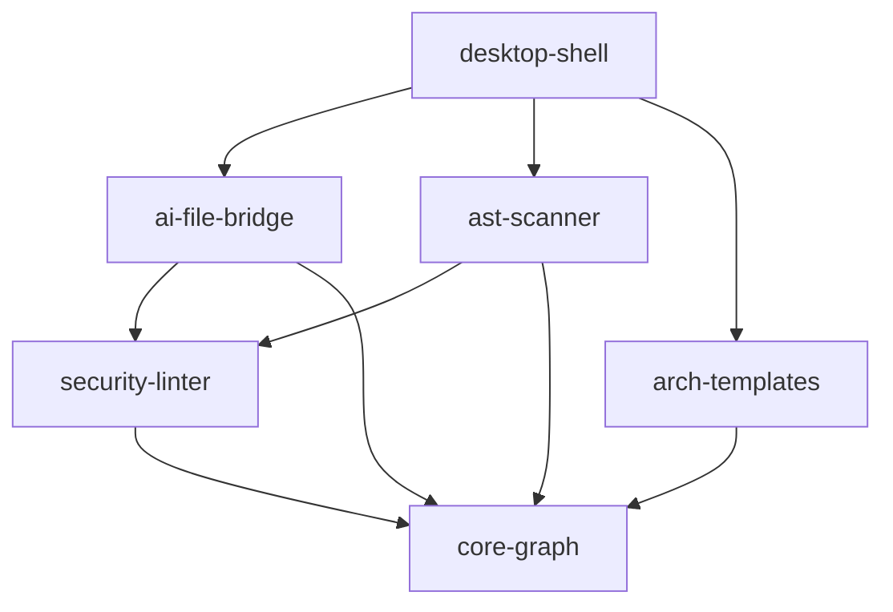

# 📚 crates — Workspace Cargo

Six crates en architecture hexagonale. Les dépendances vont toujours vers le bas :

| Crate | Couche | Rôle |
| :--- | :--- | :--- |
| [core-graph](./core-graph) | domain | Modèle du graphe, layouts |
| [security-linter](./security-linter) | domain | SAST, lexer, contrats BLAKE3 |
| [ast-scanner](./ast-scanner) | application | Scanner AST polyglotte |
| [ai-file-bridge](./ai-file-bridge) | infrastructure | Watcher, tâches, handshake |
| [arch-templates](./arch-templates) | utility | Scaffolding multi-stack |
| [desktop-shell](./desktop-shell) | api | Binaires, API locale, MCP, cockpit |

## 🛡️ Règles EARS

- WHEN a crate is added THE SYSTEM SHALL provide a contract `README.md` in its folder.
- IF a lower-layer crate imports a higher-layer crate THEN THE SYSTEM SHALL report a forbidden import violation.
